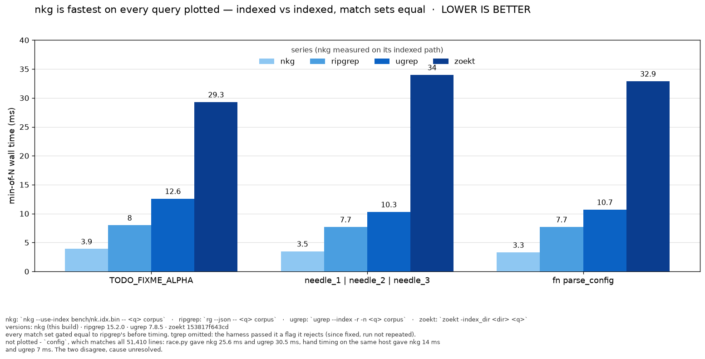

# nkgrep

nkgrep is a ranked code search tool. Given a pattern, it returns the k
highest-scoring matches. It combines a trigram index with best-first
verification: on plain literal queries it returns exactly the match set
of ripgrep, ordered by relevance score.

## Install

```bash
cargo install nkgrep
```

Or build it yourself (crate stays `nkgrep`, the binary is `nkg`):

```bash
cargo build --release
./target/release/nkg --version
```

## Quickstart

```bash
# index the repo once - a .bin path writes the fast binary
# format, any other extension writes JSON
nkg index . --index .nkg.bin

# serve it in the background
nkg serve --index .nkg.bin --port 17632 &

# ask for the 20 best hits
nkg --port 17632 --top 20 -- 'TODO|FIXME'
```

No server? No problem — plain one-shot search works too:

```bash
nkg -- 'pattern' src
```

Each hit comes back as one JSON object per line:

```json
{"path":"a.txt","line":1,"text":"hello world","score":-4.000001}
```

## Performance



**Lower is better.** Each bar is one whole CLI invocation — process
spawn, index load, search and output — against a prebuilt index, and every
tool's match set is gated equal to ripgrep's before it is timed. Every
indexed contender is measured on its indexed path; ripgrep is the scan
baseline. One run on one 32-core host; reproduce with
`python3 bench/race.py`.

The index is 2.3 MB, against zoekt's 22.7 MB and ugrep's 3.1 MB.

`tgrep` is absent from that run: the harness passed it a flag it rejects,
which is fixed but not yet re-run. A fourth query matching all 51,410
lines is also omitted — two measurements of it disagreed and the cause is
unresolved.

Index to a `.bin` path. The JSON format exists for debugging; which one is
faster is not claimed here because no script in this repo measures it.

## Learn More

- Bench (`bench/README.md`) — full numbers, corpora, and how to re-run everything.
- Man (`man/nkg.1`) — every flag, exit code, and example.
- Completions (`completions/`) — shell setup for bash, zsh, and fish.
- Src (`src/README.md`) — architecture and extension points.
- Tests (`tests/README.md`) — match-set equality contract and fixtures.

## License

Apache-2.0 — see [LICENSE](LICENSE).
